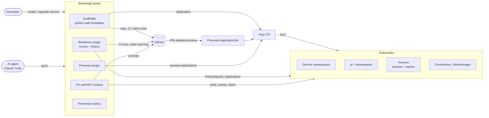

# Internal Developer Portal

[](https://github.com/Omar-Sa03/internal-developer-portal/actions/workflows/ci.yml)

A [Backstage](https://backstage.io) based developer platform that answers one question for every
service: **is it safe to ship?** It scores production readiness from live cluster and CI signals,
gives every pull request its own environment, keeps services on the latest golden path with
automated upgrade PRs, and lets an AI agent investigate incidents through the portal.

## The problems it solves

| Problem                                                                           | What the platform does                                                                                                                                                     |
| --------------------------------------------------------------------------------- | -------------------------------------------------------------------------------------------------------------------------------------------------------------------------- |
| Nobody knows which services are missing probes, owners, docs or have open CVEs    | **Readiness scorecards**: every service gets a 0-100 score (A-F) from Kyverno policy reports, Argo CD health, CI status, code scanning, ownership and docs, with fix hints |
| Testing a pull request means merging it or running everything locally             | **PR preview environments**: label a PR `preview` and Argo CD deploys it to its own namespace and URL; closing the PR tears it down                                        |
| Services generated from a template fall behind as the template evolves            | **Golden path drift detection**: services record their template version, drift lowers the score, and one click opens an upgrade PR that never touches application code     |
| During an incident the context is spread across kubectl, Argo CD, Grafana, GitHub | **AI on-call assistant**: MCP actions expose pod state, events, deployments, alerts and recent commits, scoped to what the caller may see                                  |

## Architecture



Everything in the cluster is declared in Git: [`platform/bootstrap`](platform/bootstrap) installs
Argo CD, which then installs Kyverno, monitoring, policies and the preview ApplicationSet from
[`platform/argocd/apps`](platform/argocd/apps) (app-of-apps).

## Features

### Production readiness scorecards

[`plugins/readiness-backend`](plugins/readiness-backend/README.md) evaluates every component every
30 minutes and stores the history. Checks are weighted; warnings earn half credit, and checks that
do not apply or cannot be evaluated are excluded so a broken integration never punishes a service.

| Check                            | Signal                                        |
| -------------------------------- | --------------------------------------------- |
| Owned by a team                  | `spec.owner` resolves to a synced GitHub team |
| Has documentation                | TechDocs configured                           |
| Has a monitoring dashboard       | Grafana dashboard linked                      |
| Complies with cluster policies   | Kyverno `PolicyReport`s (severity-aware)      |
| Deployed and healthy via Argo CD | Application health and sync status            |
| Default branch CI is green       | Latest GitHub Actions run                     |
| No critical vulnerabilities      | GitHub code scanning alerts (Trivy SARIF)     |
| On the latest golden path        | Template version drift                        |

The UI ([`plugins/readiness`](plugins/readiness/README.md)) adds a scorecard to every component
page and a `/readiness` leaderboard.

### Pull request preview environments

The [`previews` ApplicationSet](platform/argocd/apps/previews.yaml) combines an SCM provider
generator (all org repos with the `idp-service` topic) with a pull request generator (PRs labelled
`preview`). Each PR becomes an Argo CD Application in `pr-<number>-<service>`, restricted by the
`idp-previews` AppProject and given a ResourceQuota by a Kyverno generate policy. The service CI
builds the PR image and comments the URL; a daily workflow removes the label from idle PRs so
stale environments are cleaned up declaratively. The **Previews** tab
([`plugins/previews`](plugins/previews/README.md)) lists live environments per service.

### Golden path with drift detection and upgrades

[`templates/python-fastapi`](templates/python-fastapi) scaffolds a FastAPI service with metrics,
health probes, a hardened Dockerfile, Helm chart, CI (tests, Ruff, Trivy, GHCR, image-bump PRs),
TechDocs and a runbook, then creates the repository, the Argo CD Application and the catalog
entry. The template version lives in one place and is stamped into every service.
[`upgrade.yaml`](templates/python-fastapi/upgrade.yaml) re-renders the latest skeleton and opens a
PR that only touches platform-owned files (CI, Helm, Dockerfile, docs config). See the
[changelog](templates/python-fastapi/CHANGELOG.md).

### AI on-call assistant over MCP

[`plugins/oncall-backend`](plugins/oncall-backend/README.md) registers read-only MCP actions
(`get-workload-status`, `get-deployment-status`, `get-firing-alerts`, `get-recent-changes`). With
`readiness.get-readiness-score` and the catalog actions, an agent connected to
`/api/mcp-actions/v1` can explain why a service is unhealthy and what changed before it broke.

### Security model

- GitHub sign-in with users and teams synced from the GitHub org.
- Role-based [permission policy](packages/backend/src/permissions/policy.ts): `platform-team` has
  full access, guests are read-only, developers can only delete entities their team owns and
  cancel their own tasks.
- Every plugin endpoint and MCP action resolves entities with the caller's credentials.
- The scaffolder can only deploy through the `idp-services` AppProject (org repos only, no
  platform namespaces, no cluster-scoped resources) and rejects reserved namespaces itself.
- Kyverno audits probes, resource limits, non-root containers and the image registry.
- Third-party security scanning actions (Trivy, SARIF upload) are pinned to commit SHAs.

## Getting started

| Requirement        | Version / notes                                  |
| ------------------ | ------------------------------------------------ |
| Node.js            | 22 or 24                                         |
| Yarn               | 4 (via Corepack)                                 |
| Docker, kind, helm | for the local cluster                            |
| GitHub org         | with teams, an OAuth App and a token (see below) |

1. **Install:** `yarn install`
2. **Configure secrets** in `app-config.local.yaml` (gitignored):

   ```yaml
   integrations:
     github:
       - host: github.com
         token: <PAT with repo, workflow, read:org, read:user, user:email>
   auth:
     providers:
       github:
         development:
           clientId: <OAuth App client id>
           clientSecret: <OAuth App client secret>
   ```

   The OAuth App callback URL is `http://localhost:7007/api/auth/github/handler/frame`.

3. **Start the cluster** (optional for the portal, required for deployments and previews):

   ```sh
   GITHUB_TOKEN=<token> bash platform/bootstrap/bootstrap.sh
   ```

   Argo CD: http://argocd.localtest.me:8080, Grafana: http://grafana.localtest.me:8080

4. **Start the portal:** `yarn start`, then open http://localhost:3000.

## Repository layout

```
packages/app               frontend (new frontend system)
packages/backend           backend and permission policy
plugins/
  readiness(-backend)      readiness scorecards
  previews(-backend)       PR preview environments tab
  oncall-backend           MCP actions for incident investigation
  scaffolder-backend-module-argocd   argoCd:createApplication action
templates/python-fastapi   golden path template, upgrade template, changelog
platform/
  bootstrap                kind cluster + Argo CD bootstrap
  argocd/apps              app-of-apps: Kyverno, monitoring, AppProjects, previews
  policies                 Kyverno cluster policies
docs/adr                   architecture decision records
```

## Development

| Command          | Description                      |
| ---------------- | -------------------------------- |
| `yarn start`     | Frontend and backend in dev mode |
| `yarn tsc`       | Type check                       |
| `yarn lint:all`  | Lint everything                  |
| `yarn test:all`  | All tests with coverage          |
| `yarn build:all` | Build all packages               |

CI runs type checking, lint, tests, Kubernetes manifest validation and a backend image build on
every push and pull request.

## Design decisions

Key trade-offs are recorded in [`docs/adr`](docs/adr):

1. [Custom readiness plugin instead of Tech Insights](docs/adr/0001-custom-readiness-plugin.md)
2. [Preview environments with an ApplicationSet](docs/adr/0002-previews-with-applicationset.md)
3. [Label-driven preview expiry](docs/adr/0003-label-driven-preview-expiry.md)
4. [Ownership boundary for golden path upgrades](docs/adr/0004-golden-path-ownership-boundary.md)
5. [MCP actions act with the caller's permissions](docs/adr/0005-mcp-actions-with-caller-permissions.md)
